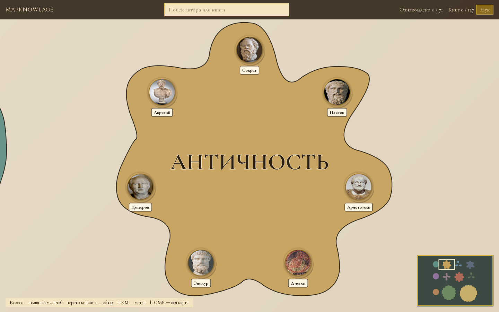

# MapKnowlage

**An interactive map of the history of philosophy.** Schools are drawn as regions, philosophers as portraits on the map, and each one leads to their books. Track what you have read in a reading journal.




## Features

- **11 schools, 71 philosophers, 127 books** on a zoomable, draggable map.
- **Procedural region shapes and textures** (OpenSimplex noise, SciPy).
- **Minimap, search, markers** and a reading journal with progress stored in SQLite.
- **Sound effects and custom fonts**; packaged as a Windows `.exe`.
- `tools/` scripts build the catalog and download portraits from Wikipedia with attributions.

## Run

```bash
pip install -r requirements.txt
python main.py
```

Portraits: Wikimedia Commons, see `assets/portraits/attributions.json`. Fonts: SIL Open Font License.
